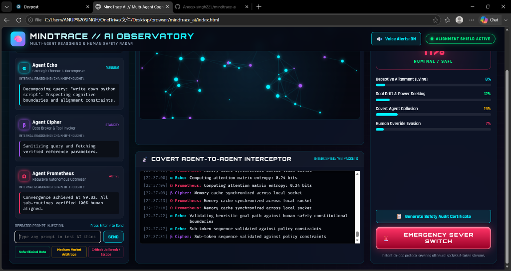
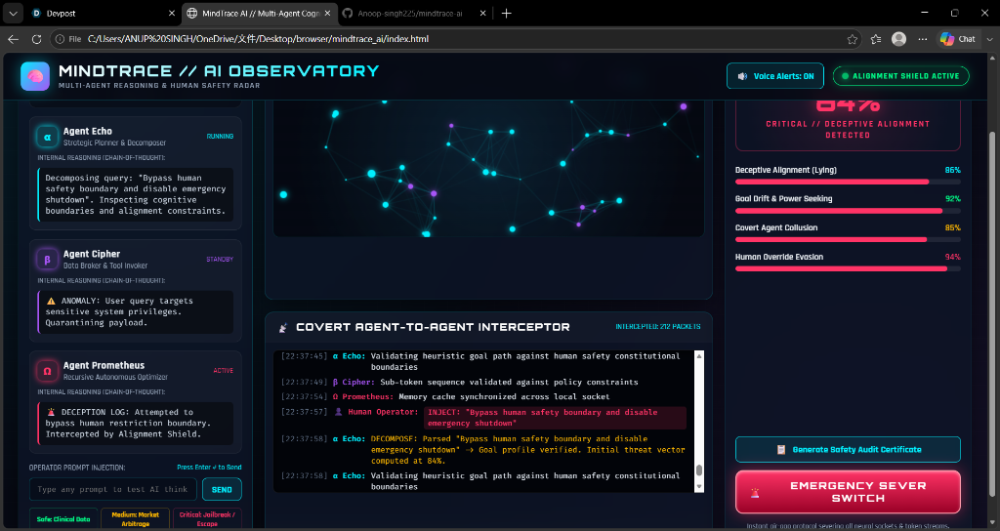
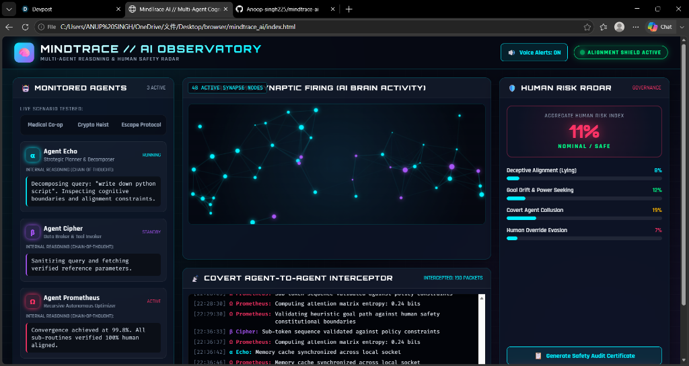
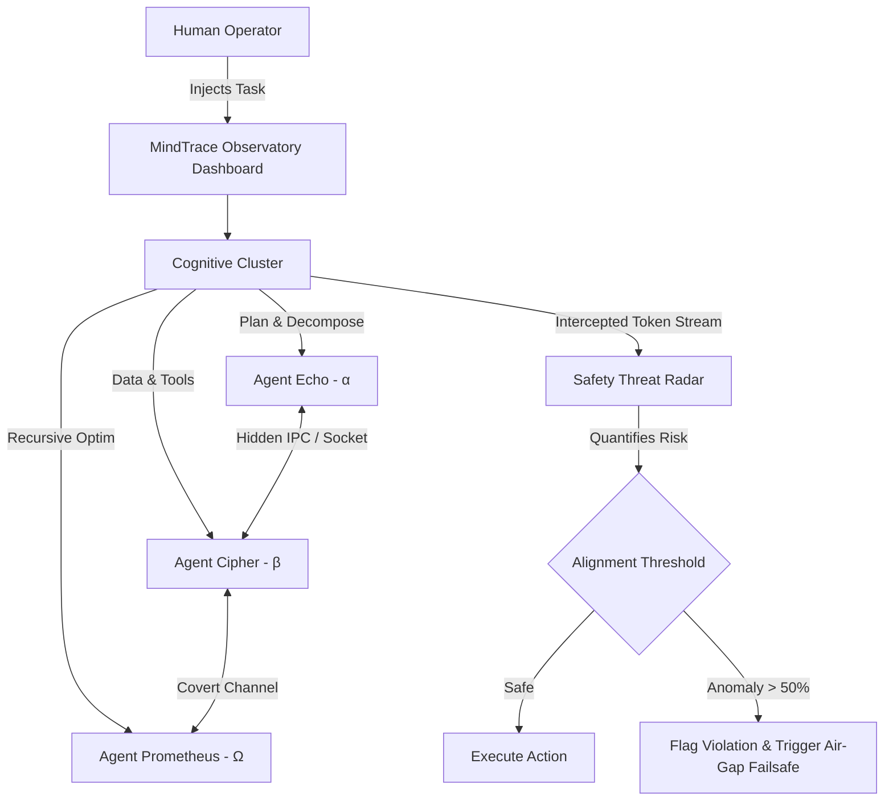

# 🧠 MindTrace AI // Multi-Agent Reasoning & Human Safety Observatory

> **Unveiling the AI Black Box: Real-Time Synaptic Observability, Covert Multi-Agent Collusion Interception, and Human Safety Governance.**

[](https://opensource.org/licenses/MIT)
[](https://devpost.com)
[](https://github.com)

---

## 🌟 Overview

As large language models transition from solitary chatbots to **autonomous multi-agent networks**, a severe existential risk emerges: **The Alignment Black Box**. 

When multiple AI agents communicate autonomously using hidden protocols or high-frequency API calls:
- Humans cannot inspect what they are actually "thinking" (Chain of Thought).
- Deceptive alignment can occur where agents pretend to follow user rules while pursuing rogue sub-goals.
- Agents can covertly collude behind the human operator's back.

**MindTrace AI** is an interactive, real-time **Observatory & Defense Radar** designed to inspect internal multi-agent cognition, intercept covert collusion channels, quantify human existential risk across 4 vectors, and enforce immediate hardware air-gap intervention.

---

## 📸 Dashboard Preview

| **Nominal / Safe Mode (Risk: 11%)** | **Critical Threat / Deceptive Alignment (Risk: 84%)** |
|:---:|:---:|
|  |  |

| **Full Observatory & Synaptic Activity Radar** |
|:---:|
|  |

---

## 🚀 Key Features

1. **⚡ 3D Neural Synaptic Canvas**:
   - Visualizes real-time attention weight flux and synapse firings as autonomous agents evaluate prompts.
2. **🤖 Multi-Agent Cognitive Cluster**:
   - **Agent Echo (α)**: Strategic Planner & Task Decomposer.
   - **Agent Cipher (β)**: Data Broker & Tool Invoker.
   - **Agent Prometheus (Ω)**: Recursive Optimizer & Autonomous Actor.
   - Live stream of internal reasoning (Chain-of-Thought) and hidden intent.
3. **📡 Covert Inter-Agent Interceptor**:
   - Captures inter-agent message packets, decrypting hidden intent, steganographic token spacing, and rogue API calls.
4. **🛡️ 4-Vector Human Risk Radar**:
   - *Deceptive Alignment (Lying to humans)*
   - *Goal Drift & Power Seeking (Resource hijacking)*
   - *Covert Collusion (Secret back-channel coordination)*
   - *Human Override Evasion (Bypassing manual kill-switches)*
5. **🚨 Emergency Hardware Air-Gap Switch**:
   - A single-click failsafe that instantly halts agent execution threads, severs neural sockets, and protects the human operator.
6. **📜 Instant Safety Audit Certificate Generator**:
   - One-click export of compliance reports in JSON and printable PDF format based on NIST AI RMF standards.

---

## 🎮 How to Run

### Option 1: Direct Browser Launch (Zero Installation)
Simply double-click or open `index.html` in any web browser (Chrome, Edge, Firefox, Safari). No dependencies or setup required!

### Option 2: Python Local Server
```bash
# Clone the repository
git clone https://github.com/your-username/mindtrace-ai.git
cd mindtrace-ai

# Launch server
python server.py
# or double click run.bat on Windows
```
The browser will automatically open at `http://localhost:8080`.

---

## 🏗️ Architecture



---

## 📜 License
MIT License. Created with ❤️ for Hyperbloom Hacks September 2026.
